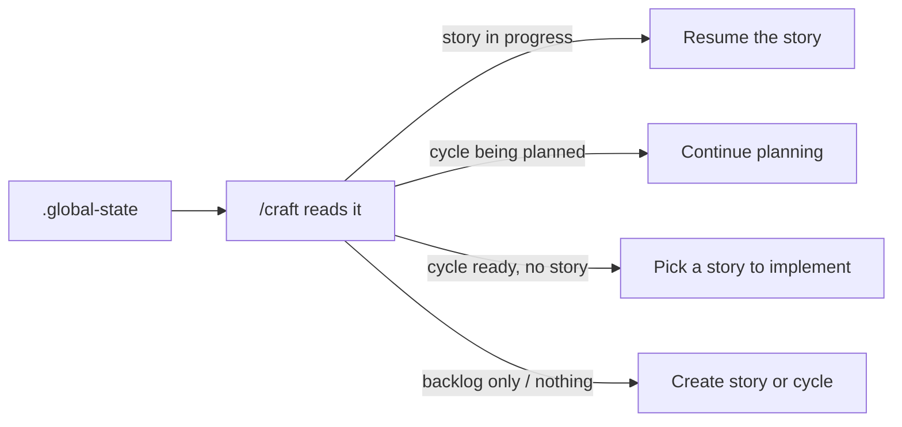

<div align="center">

# Craft

**Stop Vibing. Start Crafting.**

[](CHANGELOG.md)


[](https://www.claudepluginhub.com/plugins/drobins25-craft?ref=badge)

**[Install](#install)** · [Getting Started](#getting-started) · [Commands](#commands) · [How it works](#how-craft-work-flows) · [What's New](CHANGELOG.md)

### Point at the page. Watch it change.

One comment sheet, built into three commands.


<sub><code>/craft:annotate</code> on a real page, sped up. No file changes while you point.</sub>

</div>

| [`/craft:annotate`](docs/annotate.md) | [`/craft:mockup`](#the-mockup-funnel) | [`/craft:dial`](#the-mockup-funnel) |
|---|---|---|
| Turn on COMMENT MODE on the tab you have open. Each pin lands as a live change while you watch. | Every round of options arrives with the comment sheet aboard. Pin what you'd change, and the next round reloads in place. | Say you want to point, and the comment sheet joins the A, B, C, D panel. Each pin knows which letter was on screen. |

Craft is a Claude Code plugin that asks you the product questions and works out the technical ones. Features get planned, built, and tested, with your codebase read-only until you approve the work. Point at a live page to change it. The calls you make - decisions, design tokens, the tweaks you loved - carry into every build after.

Claude's Write and Edit tools stay gated until you open a channel: a planned story, an investigated fix, a live tweak, or an approved one-off. Shell commands aren't gated - the gate covers Claude's file tools, not the terminal.

Install in about a minute:

```
claude plugin marketplace add drobins25/craft
claude plugin install craft@craft
```

Then start Claude Code and run `/craft` - [full install notes](#install).

## A Write Gate, decision memory, and a taste engine for Claude Code

| **Write Gate** | **Decision memory** |
|---|---|
| Write and Edit stay blocked on every project file until you open a story, an adhoc fix or tweak, the approve skill, or a workflow. Shell isn't gated - a workflow gate, not a sandbox. | Name the rulings a story carries in `/craft:decisions`; the planner reads them first. Waiving a locked decision always asks. |
| **Taste engine** | **QA that files its own bugs** |
| `/craft:adhoc` tweaks stamp loved or routine; three loved and craft offers to spread the look. Accepted mockups can become tokens - tokens and locks guide every mockup after. | `/craft:analyze qa` drives a real browser - clicks, forms, console. Confirmed and likely findings file into `/craft:bugs`; repeats add sightings. |

Same Claude Code session. Less re-explaining what you already decided, more building on top of it.

**It steals your best ideas back.** You say "that's it!" after working through a tweak, and craft remembers. It waits, then brings that same taste back on a completely different feature - elevated. Keep going, and you'll catch yourself asking, "how did I do this?"


*Craft building its own repo page, live.*

> [!TIP]
> **Don't want to read any of this?** You don't have to.
>
> Just say it to craft, in your own words:
>
> > *"How can the craft guide agent help me solve this?"*
>
> The read-only `guide` agent auto-triggers on questions like that and answers from craft's actual source, not vibes. No command to memorize - though `/craft:guide` is there if you want to reach it on purpose.

## Built with Craft

Craft has shipped real, public products across different domains - click through and see working software:

- **[darinbuilds.com](https://darinbuilds.com)** - an immersive single-page portfolio and marketing site (Next.js, GSAP scroll), built across 30+ craft cycles.
- **[throve.fit](https://throve.fit)** - a structured daily coaching app: week-view programming, curated workouts with real coach's notes, exercise alternatives, and completion tracking.
- **[hirecalling.jobs](https://hirecalling.jobs)** - client work: a hiring platform where every job application triggers a verified, live-tracked donation to a nonprofit. Job searching that gives back.
- **[wodspark.com](https://wodspark.com)** - where craft started: a free on-demand workout generator - pick a focus, equipment, and duration, and it builds a workout instantly.

Two of these are fitness apps, and they're genuinely different products - an instant generator versus a structured coaching tool. One is paid client work, shipped for someone else's business. That's the point: the same harness shipped range, not one idea four times.

## What makes Craft different

Most Claude Code plugins ship a fixed set of helpers. Craft ships a workshop where you build your own - agents that argue from conviction, not a system prompt.

Craft's `conductor` is the AI-harness eagle eye craft itself is built under - every skill, agent, and hook in this repo was designed under its scrutiny. Ask it whether telling Claude "don't touch prod" actually protects you:

> "You can, and it'll work about 95% of the time - which means it's guaranteed to fail on the exact run you can least afford it to. Instructions are guidance, not enforcement; a rule in your CLAUDE.md is a request the model can starve out under context pressure. If breaking this would actually hurt you, that's not a prompt - that's a hook. Exit code 2 blocks. A sentence just hopes."

That's not a system prompt. It's a crystallized practitioner. `/craft:become` studies a tool, role, or person and turns it into a portable agent that argues from scar tissue earned at 2 AM on run 50 - not read from docs.

And not just for code. Here's craft's `muse`, on why technically impressive features die:

> I've watched enough launches fail - Google Wave, Fire Phone, Juicero, Google+, Facebook Home - to recognize the pattern before the metrics arrive. The pattern is always the same: the demo room loved it, the press loved it, users used it once and left. The thing that was missing was never functionality. It was always feeling.

Same machinery, different domain. You point `/craft:become` at the expertise you wish were in the room, and it crystallizes a mind you can consult - one with beliefs, refusals, and the scar tissue that makes its judgment worth trusting.

## The Mockup Funnel

`/craft:mockup` is the fastest way to feel what craft is. Name something visual and ask:

> "Can we create a craft mockup of the ecosystem cards?"

Three live HTML options open in your browser, at real scale, in real surrounding context. Stances, not variations: at most one may stay inside your current design language, and at least one has to go further than you asked. Three safe layouts in the current palette is a failed round.

You converge by reacting in plain words. No forms, no pickers.

- **Diverge.** Say which one pulls and what's wrong with the others. Hybrids are legal: "B with C's cards."
- **Refine.** Your pick becomes the base and comes back as variations of it.
- **Polish.** Micro-adjustments land in the open page while you watch. Try, see, keep or discard, seconds each.
- **A feeling counts.** "B is close but something's off" is a feeling, and craft riffs the fuzzy reaction into a sharp direction with you before rebuilding, instead of spending a round on a guess.
- **Acceptance is explicit.** "That's it, ship it." The new design values land in `tokens.yaml` with their provenance before anything downstream exists, so every later story and validator enforces the design you approved in your browser.
- **Then it graduates on your call.** Tweak it in now, grow it into a story with its CSS ported as-is, or park it as a notebook todo.

The same door takes a two-minute tweak:

> "Tweak the rim around the Start button - gradient glow, maybe?"

`/craft:adhoc` makes the change in place, shows you, and records what you said. If the accepted values drift from your tokens or outgrow a lock, craft asks once, at acceptance, whether the new taste becomes the standard. Say yes and it offers a sweep to find the other surfaces that could inherit it.

And when the page is almost there, a notch off:

> "Can we dial down the login text and try a different color perhaps?"

`/craft:dial` drops A, B, C, D into your running app, in a small panel on the page you were already looking at. You click until one stops bugging you. "Oh I like B." Nothing is written to source.

Your reactions are recorded word for word along the way. They are the convergence history, and they feed the taste record.

That's the review. You stopped describing what you wanted and pointed at it.

## Annotate

And when the page is already in front of you, you don't describe anything. You point.

> `/craft:annotate`

Craft puts a comment sheet on the tab you have open. Turn on COMMENT MODE, click anything, type what you want, press SEND TO CLAUDE. The change lands on the page while you watch. No file changes while you point.

One real run started on a plain white profile card:

> "Can you make this look a bit more like LinkedIn?"

Eleven pins later, the last one was:

> "Make craft look like it's coming off the page"

By then the card was a floating dark terminal with 3D CRAFT letters. No reload. No file touched. Then: "That's exactly what I wanted. Can we apply this change to our code now?"

> "Cleared - the page is showing real code again."

Adhoc ported the look as one tweak.

Along the way:

- **Every pin gets a live attempt.** Craft changes the page, measures the result, and tells you what the page shows, not what it meant to do.
- **Pins know their source.** Each arrives with the element you clicked and, when craft can find them, the component and stylesheet rule behind it.
- **Later pins win, and craft says so.** The terminal replaced the LinkedIn banner, and you hear which earlier changes got covered.
- **The run is one record.** Your pins word for word, where each lives in source, and the stylesheet with one block per pin, in `.craft/annotations/`.
- **It leaves on your word.** A tweak through `/craft:adhoc`, a story the record pre-fills, a notebook todo, or nothing. A run cut short is offered back next time.
- **Outside pages are untrusted.** On a page that isn't local, craft treats pins as page content, says so once, and asks before anything beyond a visual change.

The step-by-step guide is [docs/annotate.md](docs/annotate.md).

<a id="the-notebook"></a>

## The Notebook: project memory across sessions

The notebook is one-line capture for thoughts that aren't story-shaped yet. You never fill out a form. You just talk:

> "Can you check our notebook todos?"

> "Create a notebook entry for a `craft:reskin` command with optional token extraction."

- **Three kinds of entry.** Ideas that may mature into stories, todos that need doing, and notes: durable project facts future-you will want recalled.
- **Context rides along.** The active story or cycle and the code you were discussing land in the entry, so a thought here is work paused, not a promise to reconstruct from zero.
- **Craft offers, never interrupts.** Say "later", "don't let me forget", "side note", "unrelated but", "before I forget", "for next time" or "remember to" mid-story, and craft offers the notebook in one ignorable line. Never a popup.
- **Entries graduate.** An idea or todo becomes a story on your word, and the entry is stamped with the story it turned into. A todo that an adhoc tweak happens to satisfy is offered for closing when you accept the tweak.
- **Some entries won't be yours.** When enough tweaks you loved have stacked up, three by default, craft offers a victory lap: its scout looks for the other surfaces that taste belongs on and writes one todo per surface, origin tweak attached, ready for `/craft:mockup`.

> *Pricing cards - spread the hero card's taste. Your last three tweaks kept warming the palette, and these are still cold.*

You didn't ask for that one. Craft was paying attention.

That's the real reason the notebook exists: **your taste compounds.** Every design you love is recorded, not spent, and every move craft proposes from it links back to the tweak where it started. Most tools forget what you liked when the session ends. Craft keeps score.


**Not a demo - this ships with the plugin.** Run `/craft:dashboard` and it's your own project in here: every story, fix, riff, and idea you've worked through, linked and alive. Your second brain, filling itself in while you build.

*Capture syntax, lifecycle, and where files live: [Notebook](#notebook), below.*

## Why we built it this way

Most agent frameworks treat the model as fixed and harden the harness around it: prompt scaffolding, retry logic, validation chains, every guardrail imaginable. Craft makes the opposite bet. Claude keeps getting smarter; we build around the capability curve instead of fighting it. The harness checkpoints for safety, not for control.

Craft is built with craft. This plugin and the projects shipped with it went through the same cycles, the same locked decisions, the same checkpoints you'll use. Craft does docs the way craft does code.

*The longer story - four months of craft building craft - is in ["I built Craft for myself. Now it's running me"](https://darinbuilds.com/writing/i-built-craft).*

**Creativity as default. Smart execution follows.**

## How Craft compares

Most tools in this space are a different shape than Craft. Here's the lay of the land:

| Tool | What it is | Reach for it when |
|------|-----------|-------------------|
| CrewAI, LangGraph, claude-flow | SDKs - you write the code that assembles agents and wires up orchestration | You want to build an agent system from parts |
| OpenHands, Aider | Standalone agents that bring their own runtime to drive your repo | You want an agent that owns the terminal |
| Cursor | An AI-native editor | You want AI woven into where you type |
| Agent OS | A tool-agnostic spec layer you drop into any assistant | You want portable specs across tools |
| **Craft** | **A plugin inside Claude Code that paves the workflow and gates the writes - changes land only through channels you open** | **You want agent speed without handing over custody of your codebase** |

Craft doesn't compete with LangGraph at the SDK layer - it adds creative ideation, locked decisions, checkpointed execution, and crystallized expert agents on top of the Claude Code session you already have.

**Closer to home:** the comparison people actually ask about is other Claude Code workflow plugins - Superpowers, or spec-driven tools like Kiro. The honest answer: the planning discipline overlaps. Plan first, implement against the plan, review after - several tools deliver that loop, and it's good discipline wherever you get it.

What the others don't have is the part that compounds across sessions:

- **A workshop for your own expert agents** (`/craft:become`) - minds that argue from scar tissue, not a system prompt.
- **A mockup funnel whose accepted designs solidify into enforced tokens** - the taste you approved, enforced from then on.
- **A notebook that records what you loved** - votes for what "good" means in your project.

And a harness that doesn't just work with you, it pries at you - pulling the creativity out of your head and onto the page. Every time that works, it pries further: what you loved last session is where the next one starts. A bare Claude session can do any one of these things once, then forgets the moment it ends. Craft keeps the record and enforces it - which is why week four feels nothing like day one. None of it is frontend-only: the same loop ships legacy C# as comfortably as greenfield Next.js.

## How Craft fits with what you already use

Craft is a Claude Code plugin - it runs inside `claude` CLI sessions and adds opinionated workflow on top. What that means in practice:

- **Your editor stays.** Cursor, VS Code, JetBrains, a bare terminal - whatever you write code in is untouched. Craft doesn't replace it.
- **Other Claude Code plugins coexist.** Craft layers on; it doesn't take over the session.
- **Your existing prompts still work.** Craft replaces the ad-hoc planning and validation prompts you've been hand-rolling - but only if you adopt the full loop.
- **No Claude Code, no Craft.** It's a layer on Claude Code, not a standalone tool. If you're not using Claude Code, this isn't for you.

## What you can do, and when

**First session.** Install, run `/craft` - it's the front door, and it knows what to do with a brand-new project. Then ship one small thing:

- **Start building your taste with a mockup or a tweak.** `/craft:mockup` introduces muse and alchemist, your first two crystallized agents: muse asks what it should feel like, alchemist builds three live directions to react to - even in an empty folder. Or tweak something already built - an icon, a wording change. Either way, what you love gets remembered. That's the taste engine starting.
- **Or fix that bug that's been hanging around.** `/craft:adhoc` names the root cause, checks its confidence with you, then fixes and validates. No ceremony.
- **Or build something small and new.** `/craft:story-new` → `/craft:story-implement`, and watch the implement → validate → refine loop run for the first time.

You don't have to type these commands, by the way - say it in your own words ("mock up a landing page", "that icon's wrong", "fix the login redirect") and craft opens the right door. Whichever it is, you'll have real work shipped within the hour.

**By week two.** Plan a real cycle and run multiple stories through it. Watch the chunk-validator + refine-chunk loop catch failures and route them to fixes without you babysitting. Run the analyzer agents post-cycle via `/craft:analyze`. Consult one of the crystallized experts via `/craft:ask` when you're stuck on a design call.

**After a month.** You stop hand-rolling the prompts you used to write every time. No more ad-hoc planning, no improvised validation chains, no choreographing the steps of a pairing session yourself. The harness owns that loop. You spend your attention on what to build, not on the routine of building.

## Core Principles

1. **Quality is Pristine by Default** - Stripe, Linear, Vercel level. Not "good enough."
2. **Nothing Happens Without Approval** - Claude advises, you decide.
3. **Claude Always Offers Suggestions with Reasoning** - Not just options, recommendations.
4. **Perfection Gets Locked** - Approved patterns become enforced standards.
5. **Quality Only Evolves Upward** - Can add requirements, never remove.
6. **Claude Self-Critiques Before Complete** - Compares against your standards.
7. **The Harness Evolves** - Gets smarter with every cycle.

## Install

> Requires Claude Code 2.1 or later. Tested on macOS and Linux; on Windows, WSL is recommended (native + Git Bash should work but is untested).

Two commands from your terminal, then launch Claude Code - about a minute, start to finish.

```
claude plugin marketplace add drobins25/craft
claude plugin install craft@craft
```

The first command registers the **craft** marketplace by cloning this repo to `~/.claude/plugins/marketplaces/craft/`. The second installs the plugin from it.

Then start Claude Code - the plugin loads on launch. (Already in a session? Run `/reload-plugins` instead.)

Verify it worked:

```
/craft
```

You should see the Craft entry-point prompt. If you don't, run `/plugin` and check that the **craft** marketplace (drobins25/craft) is listed with the plugin installed.

One thing to expect once craft is enabled: Claude starts hinting when a craft feature fits the moment - most visibly at session start, when a story or cycle completes, and when you make small tweaks and fixes. Say "don't let me forget..." mid-session and the orchestrator offers to drop it in your notebook - one ignorable line, never a popup. You don't need to memorize the command table below; the harness surfaces the right door.

### Updating craft

Craft keeps itself current. Once a day, shortly after a session starts, it runs in the background the same command you could run yourself:

```
claude plugin update craft@craft
```

The new version loads in your next session. The first time this runs you see a one-line notice; after that it is silent unless a new version landed. Nothing about you or your project is sent anywhere: the only network call is a `git fetch` of this repository, and the only files touched are craft's own under `~/.claude/plugins/`.

To turn self-update off, use any one of these:

- `CRAFT_AUTO_UPDATE=0` in your environment
- a marker file at `~/.claude/plugins/data/craft-craft/no-auto-update`, for launches that do not load your shell profile
- Claude Code's own `DISABLE_AUTOUPDATER` or `CLAUDE_CODE_DISABLE_NONESSENTIAL_TRAFFIC`

With it off, run the command above to update by hand.

### One setting worth knowing about

In `/craft:mockup`, craft brings the alchemist back after each of your reactions. Claude Code keeps a subagent's context cached for 5 minutes, so if you take longer than that to react, the alchemist's whole context is sent again. If you often sit with a mockup that long, you can stretch the cache to an hour in `~/.claude/settings.json` (Claude Code 2.1.242+):

```json
{ "subagentPromptCacheTtl": "1h" }
```

It's a tradeoff, not a free win. An hour-long cache costs more to write than a 5-minute one, so if you rarely pause for more than five minutes, the default is usually cheaper.

## Getting Started

### New project or existing?

Both paths start with `/craft:init` - and it's much more than scaffolding. Where you're starting decides what it does:

**Empty folder, brand-new project.** This is by far the funnest route in craft. Full setup walks you through:

- **Your intent, in your words.** Two short questions about what you're building, then craft's muse distills them into the project's Emotional Core - the job, the killer moment, the share trigger. Every cycle you plan later reads it.
- **Design pulled from inspiration.** Name the sites you admire and craft opens each one in a real browser and extracts what you point at - colors from one site, typography from another, spacing from a third - then assembles them into one design language with a name ("Linear's restraint meets Stripe's confidence"). Can't name one? Craft suggests live, verified reference sites from what you told it about your project - deliberately different directions, starting points to react against. You riff in plain words - "more warmth," "less corporate" - until it feels right. Lock it, and those tokens are enforced from then on.
- **The energy.** Steady and solid, move fast, or learning mode - validation and checkpoints adapt to match.

It ends with a real first move, not a blank prompt: **mock up a screen**, **describe a feature**, or take it from here. On a blank canvas craft recommends the mockup - three live options in your browser before a line of code, and the one that clicks becomes your first story.

**Existing project.** `/craft:init` scans your code instead of asking about it: project type, stack, conventions, and the visual patterns already in your files. A mature codebase gets its consistent patterns extracted and locked; an early one isn't guessed at - craft defers tokens and learns your visual language from what you build next. Then start small - ask Claude:

> "Can we redesign this section of my page using a craft mockup?"

or ship one targeted fix through `/craft:adhoc`. You'll see the whole loop without restructuring anything.

*Curious how `/craft` decides what to invoke? See the [decision tree](docs/decision-tree.md).*

### Capture an idea

```
/craft:story-new
```

This captures a focused unit of work - we call it a [**story**](#story) - and lands it in the backlog until you're ready to work on it. A story owns one outcome end-to-end: spark, design decisions, implementation plan, validation.

### Plan and start a batch

```
/craft:cycle-design    # design a batch of work and its stories
/craft:cycle-start     # activate the batch for implementation
```

A [**cycle**](#cycle) is a batch of related stories you ship together. Design it first (which stories, in what order), then activate it.

**Planning-sourced cycles.** If `.craft/planning/` holds concept or initiative docs, `cycle-design` detects them. Name one in conversation before you invoke, and craft confirms it, records the source on the cycle, and draws each story's spark from the planning content. Cycles without a planning source work as before.

**Planning alignment (`/craft:planning`).** A concept's strategic sub-decisions get settled before it becomes stories, one at a time, in conversation. Each lands in one of three places:

- **Locked** only after craft asks "Want me to lock this as: [its read]?" and you say yes.
- **Deferred** to `pending_decisions` in the concept's frontmatter, back next session.
- **Blocked** into `## Open questions` with the owner named. It never nags you.

A coverage gate at story creation stops if any decision closed without landing in one of the three. Planning stays strategic: implementation detail waits for story-new and plan-chunks.

### Implement

```
/craft:story-implement
```

This runs the story end-to-end. Craft flows through four beats: a creative pass to flesh the idea out, [**chunk**](#chunk) planning (each chunk is an implementable unit with a rollback boundary), execution with quality gates per chunk, and final validation. You're in the loop at each gate.

## Commands

You rarely type these. Craft routes plain English to the right one - this table is for when you want to be explicit.

*How `/craft` chooses what to invoke is mapped in [docs/decision-tree.md](docs/decision-tree.md).*

| Command | Purpose |
|---------|---------|
| `/craft` | Main entry point - start here |
| `/craft:status` | Terminal snapshot of progress - cycles, stories, backlog |
| `/craft:dashboard` | Opens the project graph page in your browser - cycles, stories, and every record, all connected |
| `/craft:notebook` | Low-ceremony capture for ideas, todos, and notes (durable project facts). Graduate / mark done conversationally - no subcommands needed for lifecycle. |
| `/craft:decisions` | The Shelf - what's waiting on you, what's ruled and ready, what a story is building, and what's done. Rule on a card, reopen or retire one, or move one to another topic. |
| `/craft:bugs` | File a bug without fixing it - one door for a person mid-conversation or an agent mid-run. Opens with the open pile; closing a bug is a word and one confirmation. See [Bugs](#bugs). |
| `/craft:riff` | Riff on an idea together - a two-player conversation in small beats, one concept at a time, until it's ready to build. Bare invocation opens from the oldest open notebook idea. |
| `/craft:story-new` | Create story (lands in backlog) |
| `/craft:story-implement` | Implement a story (interactive) |
| `/craft:story-implement-auto` | Implement a story (autonomous) |
| `/craft:story-continue` | Resume interrupted story |
| `/craft:story-archive` | Move story back to backlog |
| `/craft:story-delete` | Delete a story |
| `/craft:cycle-design` | Design a cycle (new or existing) |
| `/craft:cycle-start` | Activate a cycle |
| `/craft:cycle-assign` | Move story to cycle |
| `/craft:cycle-complete` | Complete a cycle, trigger reflection |
| `/craft:analyze` | Run QA, UX, Creative, Style, or Walkthrough analysis |
| `/craft:review` | PR-style code review - branch, story, or project audit. `--maze` flag enables perpendicular review via maze-architect. Every run on your own work leaves a record, clean or not, and every finding gets a proposed door; reviewing someone else's PR leaves nothing behind |
| `/craft:reflect` | Improve the harness based on learnings |
| `/craft:update-docs` | Re-scan project, update documentation |
| `/craft:docs` | Generate or update docs using the crystallized doc-writer agent (two-pass: brief then generate) |
| `/craft:become` | Crystallize a tool, role, or person into a portable 9-section agent with beliefs and scar tissue |
| `/craft:ask` | Consult a workshop agent - routes your question to the best available mind |
| `/craft:workflow` | Workflow router - dashboard, status, and dispatch to workflow-run or workflow-design. Full format reference: [docs/workflow-reference.md](docs/workflow-reference.md). |
| `/craft:workflow-run` | Run a workflow session - start, continue, next, run-all, batch-create, mark ready |
| `/craft:workflow-design` | Author workflow definitions - create new, edit existing, archive unused |
| `/craft:research` | Ad-hoc research - discover, elaborate, synthesize with ranked branches |
| `/craft:research-verify` | Verify existing research findings against independent primary sources |
| `/craft:adhoc` | Adhoc fix or tweak without story ceremony. Bugs record to `.craft/fixes/`, tweaks to `.craft/tweaks/`. See [Adhoc](#adhoc). |
| `/craft:mockup` | Live HTML mockup funnel - 3 options, converge by reacting, graduate to tweak/story/todo |
| `/craft:dial` | Live value calibration in the running app - 2-4 lettered candidates injected on the real page, chosen by eye, nothing written to source |
| `/craft:annotate` | Point at anything on a live tab - each pin you send lands as a live change on the page, the run is kept as a record, and it leaves as a tweak, story or todo. See [Annotate](docs/annotate.md). |
| `/craft:project` | Switch projects or cross-project dashboard |
| `/craft:init` | One-time project setup |

## Notebook

The notebook is the upstream of craft's compounding system: thoughts that aren't story-shaped yet, caught before they get lost or forced into stories too early. You never type a lifecycle command. You say what you want:

> **You:** "Turn the compounding kb idea into a story."
>
> **Claude:** "Graduate 'compounding kb idea' to a story? I'll run /craft:craft-story-new with it as the spark."
>
> **You:** "Yes."

> **You:** "I took care of the verifier todo."
>
> **Claude:** "Mark 'rename verifier error wording' as done?"

Capture is one line, typed or spoken:

```
/craft:notebook idea "compounding kb for decisions #architecture"
/craft:notebook todo "rename verifier error wording"
/craft:notebook note "project deploys on Vercel"
/craft:notebook                              # bare: list view
```

After your text, one question, "Anything to add for future-you, or skip?", and one Enter dismisses it. A `#tag` anywhere in the text moves into frontmatter and shows in the list.

- **Idea.** Half-formed, wants to mature into a story or get pruned. Graduated ideas stay in place with `graduated_to` pointing at the story.
- **Todo.** A concrete action. Done ones move to `todos/done/`. Graduating a todo to a story also closes it, and the one yes covers both.
- **Note.** A durable project fact, "project deploys on Vercel", kept for recall, not action. Notes never graduate and are never done. Each carries a facet (infrastructure, tooling, ownership, process, convention, gotcha) that decides when it resurfaces.
- **Done always confirms first,** because the file moves out of view. Passing mentions never mark anything done.
- **Craft offers, you decide.** On "later", "don't let me forget" or "side note", one ignorable line: "Worth dropping in /craft:notebook? I'd tag it #verifier #cycle-9. Otherwise I'll continue." Yes captures silently with the conversation as context.
- **Notes come back as "as of".** Every session loads a one-line index of your notes, and craft reads the full note when the work matches. A recalled note is true as of its date: verify before acting.
- **Not TaskCreate.** TaskCreate lasts one conversation. Notebook todos persist across sessions and survive cycle completion.

Entries link. `graduated_to` can point at a story, fix, tweak or dial, and a `source` written as `[[slug]]` points back at the record that spawned the entry. `/craft:dashboard` resolves them into one graph.

## Decisions

Already decided what a feature should do, but Claude Code keeps asking again?

- **The Shelf keeps the ruling.** `/craft:decisions` holds every decision by where it stands: pending with you, ruled and unclaimed, claimed by a story, or done.
- **A story carries only the decisions you name for it.** Its planner reads them first, so the plan starts from what you already ruled - even one from three sessions ago.
- **Locked decisions always ask.** Waiving one takes your yes, every time - a planning check, not a write-blocking hook.

```
/craft:decisions              # bare → the Shelf
/craft:decisions homescreen   # one topic's decisions
```

### The Shelf

Every decision, grouped by topic, each marked by where it stands:

- `?` **pending** - waiting on you.
- `○` **unclaimed** - ruled, ready for a story to pick up.
- `●` **claimed** - a story is building it.
- `✓` **done** - a story shipped it.

Name a decision and you get its card: the question, the options, and what it would become. Answer with one letter - approve, keep pending, or decline - or just say what to change and the card is redrawn. Declined decisions go to the archive with your words and are never proposed again.

Say "save this as a decision" mid-conversation and craft draws a fresh card. Once that card is ruled or put away, the desk closes. A "go with that" later on is just conversation.

### How decisions reach a story

A story carries only the decisions you name for it. Say "put the blue hero decision on this story" and it's written in. Claude never attaches one because it looked relevant. A decision you didn't name is history for that story, not law.

When the story is planned, the planner reads its decisions first and treats them as the frame the story fills in. The alignment check gets them too, so it won't ask you something a ruling already answered.

### Changing your mind

Name a ruled decision and say what changed. Craft shows exactly what would change before it writes anything. You can also retire a decision to the archive, or move decisions to another topic in plain words ("move the guides ones to wright").

Once a shipped story has built a decision, it's frozen. The record is the history of why the code looks the way it does. Change your mind and craft drafts a new decision with your changes instead of rewriting the old one.

### The finish line

When a story ships, every decision it carries turns `✓` on the Shelf. The Shelf stays a live picture of what you've ruled and what's real.

### What it looks like

> "Save that as a decision - the homescreen hero is blue."
> *The card is drawn. You type `a`. It's on the Shelf, ruled.*
> "Start a homescreen story with the blue hero decision on it."
> *The story is born knowing the hero is blue. When it ships, the decision turns ✓.*

*What shipped in 2.7.0: [CHANGELOG](CHANGELOG.md#270---2026-10-03).*

## Bugs

A bug record is something broken that you are not fixing right now, written so a session with none of today's context can reproduce it, fix it, and prove it fixed.

```
/craft:bugs                                      # bare: the open pile
/craft:bugs save button does nothing on Safari   # file one
```

Bare, it shows every open bug, newest first, with a marker on any that blocks someone's next step. With words, it files what you describe. If the conversation already holds a defect, a bare call files that one instead.

- **Four filers.** You: "log a bug", or a yes to craft's one ignorable offer when you defer something broken mid-story. An agent mid-run, which can't fix what it finds without disturbing the run. And `/craft:analyze`: QA and walkthrough findings file as bugs. A QA finding the analyzer couldn't verify is named in the report and not filed. Walkthrough taste notes queue for UX review instead. And `/craft:review`: after a review, each finding gets a proposed home and you answer in a word.
- **Never summoned.** Filing never pulls you out of what you were doing. The one question craft may ask is "What's broken?", and only when nothing in the conversation says. Then one line: filed, and where.
- **Seven required fields.** The symptom in your words as the first line, never the guessed cause. Then where it turned up, expected, actual (only what was observed), consequences (what you rank the pile by; there is no severity field), whether it blocks your next step and why, and numbered steps to reproduce from a named starting state. Craft refuses a record missing one; a field the filer can't know says "unknown" and why.
- **A Done when, if you can write it.** The check that proves it fixed, written now, before the cause is known. Optional.
- **Repeats hit, they don't refile.** The same bug seen again bumps the open record's count and logs where it recurred. A bug that keeps hitting is a pattern and usually outranks the queue. A closed bug that comes back files new.
- **Closing is one confirmation.** Say it's fixed, won't be fixed, or should close. Craft matches your words to one open bug, asks which if several fit, confirms once, and moves it to `closed/`. A reason you give becomes the verdict: "that's intended" and "can't make it happen again" are both kept outcomes. Craft never argues with a close and never reopens.
- **Judgment calls need a human eye.** A bug where the code was right but the model drew, chose, or phrased the wrong thing is never closed as fixed on an agent's word.

They live in `.craft/bugs/`, named `<date>-<slug>.md`, with `closed/` for the done ones. The folder is the truth for open versus closed, and bugs show on the `/craft:dashboard` graph. [`/craft:adhoc`](#adhoc) fixes something now; [`/craft:notebook`](#notebook) holds ideas and todos.

### What it looks like

> "Place Order does nothing with one item in the cart - log a bug." *Mid-story. One line: filed, and where. The story carries on.*
> A week later, `/craft:bugs` - *the pile, newest first, the blocker marked.*
> "The checkout one is fixed." *Craft names it, you say yes, it moves to `closed/`.*

*What shipped in 2.8.0: [CHANGELOG](CHANGELOG.md#280---2026-10-04).*

### QA that opens a browser and files the bugs

Point it at the thing you want tested:

```
/craft:analyze qa
```

Name the scope in your own words - a story, the current cycle, a few pages, the whole app - and craft confirms it before anything runs.

- **It drives a real browser.** Navigating, clicking, filling forms, watching the console - in your running app, not a code guess. No app running? It reviews the code instead.
- **Confirmed and likely findings file as bugs.** Each one lands in `/craft:bugs`, checked against the open pile first: a repeat adds a sighting to the bug you already have, not a duplicate.
- **What it couldn't verify stays out of the pile.** "Needs verification" findings are named in the report, not filed.

(Run `/craft:analyze` bare to choose between QA, UX, Creative, Style, Walkthrough, or all of them.)

From there the fix path is the one above: `/craft:bugs` shows the pile, `/craft:adhoc` fixes.

## Adhoc

Adhoc is a small change to something that already exists, made now, without the story ceremony.

```
/craft:adhoc the settings button does nothing on Safari
/craft:adhoc swap the settings icon for something more like a hammer
```

Craft sorts every request into one of two flavors and runs the matching path:

- **A fix.** Something is broken: a symptom and a root cause. Craft investigates, writes the root cause down, and asks itself one question before editing: am I 100% certain this resolves it? A hedge stops the edit and offers a story. A yes applies the fix and checks the symptom is gone, on the page where you can see it, not just in the build.
- **A tweak.** It works as built, you want it different. The gate is fit, not certainty: craft looks at the element's neighbors, matches their visual family, and checks your tokens and locks before it edits. A real design question, several plausible directions and no clear fit, isn't edited. Craft says so and suggests a mockup first.
- **"The icon looks wrong" could be either.** Craft looks before it asks. Clipped or misaligned is a fix. Renders as built but displeasing is a tweak.
- **Only your reaction closes a tweak.** Each attempt ends with "How does it look?" Your answer is recorded word for word. "Not quite" is the brief for the next attempt. Passing tests never close one.
- **Everything leaves a record.** Fixes in `.craft/fixes/`, with the workflow lesson if you say there was one, read by `/craft:reflect`'s rule pass. Tweaks in `.craft/tweaks/`, counted toward the taste pass that spreads a loved look to other surfaces.
- **It closes todos, never silently.** If the change does what an open notebook todo asked, craft names the todo and asks before closing it.
- **It stays small.** Around five files, craft stops and asks whether to make it a story. Each validated fix and each tweak attempt is committed with only the files it touched, prefixed `fix:` or `tweak:`.

Not for new features or for choosing between creative directions; adding something that wasn't there is a story. Mid-story, craft warns first. [`/craft:bugs`](#bugs) records something broken to fix later.

### What it looks like

> "The settings button does nothing on Safari." *Craft finds the root cause, says it's certain, fixes it, and confirms the click works. One commit.*
>
> "Swap the settings icon for a hammer." *The first try is committed. You say "the stroke's too thin." The second try lands.*
>
> "That's it." *The record closes as accepted, with both reactions in your words.*

## Skills

| Skill | Phase | Purpose |
|-------|-------|---------|
| `content-spark` | Creative | Surface content assumptions, capture content direction |
| `creative-spark` | Creative | Generate creative options and ideas. Supports Creative Driver step (Step 1.5) with muse/alchemist interrogators |
| `design-vibe` | Creative | Visual cohesion review across stories |
| `lock-decision` | Creative | Formalize approved decisions |
| `plan-chunks` | Creative | Transform stories into implementation plans. Supports parallel batch mode with file-based dependency verification |
| `validate-chunk` | Implement | Quick validation after chunk implementation. Derives `FILES_CHANGED` from git diff, not spec file list |
| `refine-chunk` | Implement | Targeted fixes for validation failures |
| `test-fix` | Implement | Triage failing tests, fix the right thing |
| `adhoc` | Any | Adhoc fix or tweak without story ceremony. Classifies bug vs tweak: fixes gate on root-cause confidence, tweaks on visual fit - your reaction closes them |
| `approve` | Any | Request scoped write permission from the user. Opens the write gate only after explicit AskUserQuestion approval |
| `browser` | Any | Launch a persistent playwright-cli browser session. ~4x cheaper than Chrome DevTools MCP in token cost |

## Agents

27 agents across six categories. See `docs/agent-catalog.md` for full descriptions, model assignments, and when to use each.

**Core Workflow** - run inside the implementation pipeline

| Agent | Role |
|-------|------|
| `implementer` | Owns the implement → validate → refine loop per chunk |
| `tester` | Integration tests, E2E, final validation |
| `chunk-validator` | Runs quality checks, returns structured report (haiku model) |
| `plan-chunks-agent` | Autonomous chunk planning per story - used in batch mode |
| `project-scanner` | Full project analysis for documentation updates |
| `claims-auditor` | Verifies completion claims against on-disk artifacts at story-final (haiku model) |

**Analysis** - inspect the live app post-cycle

| Agent | Role |
|-------|------|
| `qa-analyzer` | Finds bugs using browser inspection |
| `ux-analyzer` | Nielsen heuristics, accessibility, mental models |
| `creative-analyzer` | Delight moments, viral potential |
| `style-analyzer` | Token compliance, pattern consistency |
| `walkthrough-analyzer` | First-time user simulation - clicks everything, tests every state |

**Review and Research** - code review, research, verification

| Agent | Role |
|-------|------|
| `pr-reviewer-expert` | PR review crystallized from CodeRabbit - reads locked.md before any opinion |
| `maze-architect` | Generates perpendicular review questions from a diff with zero intent context (haiku) |
| `researcher` | Investigates one research sub-question, writes branch file to disk |
| `research-synthesizer` | Reads all research branch files, writes the ranked synthesis (_plan.md) and citation index (_sources.md) |
| `verifier` | Adversarial claim checker - tries to disprove findings using primary sources |
| `practitioner-reviewer` | Challenges verified claims from practical experience |

**Browser**

| Agent | Role |
|-------|------|
| `playwright-browser` | Owns a live browser session via playwright-cli. Interactive, steerable via SendMessage |

**Crystallized Experts** - consult via `/craft:ask`

| Agent | Role |
|-------|------|
| `muse` | Emotional job translator - finds why anyone will care before exploring how to build |
| `riff` | Creative riff partner - reads the room and throws, pulls, or builds on your idea; never lectures. Reached via `/craft:ask` and direct consultation; the `/craft:riff` command is a separate main-loop conversation and never invokes it. |
| `alchemist` | CSS interaction physicist - sees the browser as a physics engine |
| `conductor` | AI orchestration architect - knows which patterns hold under real conditions |
| `doc-writer` | Documentation diagnostician - crystallized from Stripe/Linear-quality practitioners |
| `product-anthropologist` | Human-truth layer - diagnoses whether a product solves a real problem |
| `crystallizer` | Psychological synthesizer that distills research into agent personas (opus model) |
| `become-researcher` | Psychological material collector for `/craft:become` - gathers beliefs, not facts |

**Guide** - understand and use craft itself

| Agent | Role |
|-------|------|
| `guide` | Read-only help agent - explains how craft works and diagnoses your `.craft/` setup; the craft analog of Claude Code's docs agent. Auto-triggers, or reach it via `/craft:guide` |

## How craft work flows

> A kitchen has prep, line, and pass - three stations, same kitchen, different work as the dish comes together.

### Creative Phase
*The prep station.*

Story creation, design, planning, and locking decisions. Write access restricted to `.craft/` (no source-code edits) - the harness is in creative [**mode**](#mode). Active skills: content-spark, creative-spark, design-vibe, lock-decision, plan-chunks.

### Implement Phase
*The line.*

Autonomous execution against a ready story. The implementer builds each chunk; chunk-validator checks it; failures route to refine-chunk or test-fix. Full write access, gated by the active story.

### Analysis Phase
*Tasting after service.*

Post-cycle review triggered by `/craft:analyze`. Five analyzer agents (QA, UX, Creative, Style, Walkthrough) scan what shipped to surface bugs, friction, missed opportunities, and design drift. QA findings and the walkthrough's `blocks-ship` and `looks-wrong` findings file as [bug records](#bugs); `feels-off` and `nitpick` findings queue for UX review.

## How `/craft` routes

`/craft` is not a menu. It reads your project's state and picks the next action. The same command does different things depending on what's already in flight.



For the complete routing map across every command - fast paths, state recovery, request gates, the works - see [docs/decision-tree.md](docs/decision-tree.md).

State is the input. There are no flags, no subcommand picker. Whatever is true on disk determines the route.

## Directory Structure

After initialization, your project will have:

```
.craft/
├── backlog/              # Stories waiting to be worked
├── cycles/               # Time-boxed work containers
│   └── 1-auth/
│       ├── cycle.yaml
│       ├── .state
│       └── stories/
├── checkpoints/          # Chunk rollback points
├── fixes/                # Adhoc fix records (created by /craft:adhoc, bug path)
├── tweaks/               # Tweak records (created by /craft:adhoc, open until accepted)
├── bugs/                 # Open bug records (created by /craft:bugs)
│   └── closed/           # Fixed or won't-fix bugs
├── analysis/             # Persistent analysis findings
│   └── pending/          # Findings queues (survive sessions)
├── inspiration/          # Reference library
├── design/
│   ├── tokens.yaml       # Design tokens (enforced)
│   ├── components.md     # Component patterns
│   ├── locked.md         # Approved patterns (enforced)
│   └── .confidence-signals.yaml  # Scan signals: token confidence + total_files (init's kickoff menu reads it)
├── workflows/            # Reusable multi-step workflows
│   └── {workflow-name}/
│       ├── definition.md # Routing table for stages
│       ├── stages/       # Per-stage briefs (stages-v1 format only)
│       └── sessions/     # Per-run instances with progress + artifacts
├── requests/             # External feature requests
│   └── processed/        # Requests routed to stories or cycles
├── docs/                 # Documentation briefs (created by /craft:docs)
├── research/             # Ad-hoc research folders (created by /craft:research)
├── mockups/              # Mockup artifacts (created by /craft:mockup): [date]-[slug]/ with mockup.html + record.md
├── dials/                # Dial session records (created by /craft:dial, born closed - no lifecycle)
├── annotations/          # Annotate records (created by /craft:annotate): [date]-[slug]/ with record.md + session.css
├── notebook/             # Ideas, todos, and notes (created by /craft:notebook)
├── decisions/            # Decision records (created by /craft:decisions)
├── project.md            # Project DNA
├── quality.yaml          # Quality gates
├── settings.yaml         # Craft settings
├── .global-state         # Current state
└── .continuation         # Breadcrumb for skill continuation (transient)
```

## Hooks

Craft uses 7 hook events to manage state, enforce permissions, and track progress:

- **SessionStart** - Load context, set status line
- **PreToolUse** - Gate writes by the write gate (`CRAFT_WRITE_ENABLED`; `.craft/`, `.claude/`, `dev_mode`, and active workflows pass), check vocabulary on writes, run the push gate on Bash, and hold tool calls outside a short allowlist while an annotate session is on a page outside the project
- **PostToolUse** - Track file changes, update progress
- **PostToolUseFailure** - Log and recover from failures
- **PreCompact** - Export progress before context compaction
- **UserPromptSubmit** - Inject active cycle/story context, and lift the annotate outside-page hold for one turn when you type a message
- **Stop** - Guard against unclean stops

## Quality Gates

Two kinds of gates run on every story - the ones a script can verify, and the ones an agent has to look at.

### Automated gates

Run by the `chunk-validator` agent after every chunk:

1. **TypeScript Strict** - tsconfig.json must have `strict: true`.
2. **Lint** - the project's lint script must pass.
3. **No Any Types** - no `any` annotations in production source (test files exempted).
4. **Build** - story-final only. The project's build script must succeed.
5. **Tests + Coverage** - story-final only. Affected tests must pass.
6. **Design Tokens** - hardcoded values in UI code that should reference `tokens.yaml` get flagged.
7. **Visual Binding Assignment** - when a chunk's contract names the token a visual element must use, the element must carry that token, not merely some valid one. Best-effort: a mismatch warns.
8. **Citation Scan** - story-final only. Code comments citing craft planning artifacts ("Chunk 3", "Story 4", tokens.yaml key paths) get flagged - comments should say why, not which planning step wrote them.

Failures route to `refine-chunk` (build/lint) or `test-fix` (tests). FAIL is FAIL - no override.

### Beyond npm: verified command gates

The built-ins auto-detect npm-shaped projects. For everything else, .NET, Go, Python, Rust, Make, monorepos, craft never guesses. It measures what it can see and says what it can't.

- **A coverage line on every report.** A fast probe fingerprints which toolchain manifests your repo has. When every one is measured, the `Gates` row reads `full coverage`; otherwise it names what isn't.
- **One real question, once.** When a chunk passes while a toolchain sits unmeasured, craft asks whether to wire up a gate for it. Decline and it confirms what you're waiving, then never asks about that toolchain again. No answer means the question returns next time; a timeout is not a decision. Autonomous runs ask at launch, while you're still at the keyboard.
- **Declined stays visible.** A waived toolchain shows in every coverage row and in `/craft:status` as your choice, never as an accident. "Wire up the csproj" reopens it any time.
- **Setup is a draft, not a dictate.** Accept and craft proposes a command from the evidence. Your edits become the candidate, which runs once to prove it starts before anything is written. Pre-existing failures get a `blocking: false` option, so the gate catches new breakage only.
- **Only verified commands run.** The result lands in `quality.yaml` with a `verified:` date. A command without the stamp is inert. Write and verify one by hand and it's honored the same way.
- **Rot is a warning, not a failure.** If a verified command stops starting, the report warns and offers to re-verify. A gate that can't start never fails your chunk and never goes silent.

Two things worth knowing: `quality.yaml` commands run in your shell, so treat a cloned `.craft/` the way you treat package.json scripts. And declined signals live in `.craft/.gate-signals`, per machine, so on projects that gitignore `.craft/` each teammate is asked once.

### Reviewer-enforced polish

These can't be unit-tested - they need an agent reading the UI like a person. Three analyzers run post-cycle via `/craft:analyze`:

- **`ux-analyzer`** - loading states (skeletons, not spinners), error handling and recovery, empty states, keyboard navigation, and WCAG 2.1 AA accessibility. Evaluates against Nielsen's heuristics.
- **`style-analyzer`** - design token compliance (colors, spacing, type scale), responsive consistency, and animation styling. Catches drift from `tokens.yaml` and `locked.md`.
- **`walkthrough-analyzer`** - first-time-user simulation: clicks every element, checks console and network for errors, presses each keyboard binding, captures mobile/tablet/desktop screenshots, and verifies the live experience matches the design intent.

The chunk-validator confirms code health. The analyzers confirm the experience. Both run; neither replaces the other.

## A note on the vocabulary

We considered renaming chunk, spark, lock, and mode to more familiar words. We kept them because each term encodes meaning that generic words lose:

- **chunk** is "implementable unit with a rollback boundary," not just "task."
- **spark** is "creative seed before research," not just "idea."
- **lock** is "approved and enforced," not just "decided."
- **mode** is "what the harness allows you to do right now," not just "state."

Generic words flatten the opinion. The Glossary at the bottom of this README makes the choice navigable.

## Testing

```bash
./tests/run-all.sh
```

30+ bash tests covering hook scripts, state management, and lifecycle operations.

## MCP Integration

Craft uses `chrome-devtools` MCP for the Analysis Phase, and for `/craft:mockup`, `/craft:dial` and `/craft:annotate`, which work on pages open in your browser:
- Screenshot capture
- Accessibility audits
- Element inspection
- Console log capture
- Performance tracing

The browser server is launched through a small craft launcher. One saved browser profile is shared across sessions, so your logins persist. When another session already has that profile open, a session gets its own fresh window and may need to sign in there. Usage statistics and CrUX lookups are off, and the server version is pinned and bumped deliberately.

The `browser` skill (`/craft:browser`) uses `playwright-cli` as an alternative to Chrome DevTools MCP. Playwright saves accessibility snapshots to disk as YAML files (~27k tokens per task) rather than streaming them into context (~114k tokens per task) - approximately 4x cheaper in token cost. It also supports persistent named sessions steerable via SendMessage. Both tools coexist; playwright-cli is purely additive.

To use `/craft:browser`, install playwright-cli globally:

```bash
npm install -g @playwright/cli && playwright-cli install-browser
```

## Glossary

A reference view of craft's named terms. Each one encodes meaning a generic word loses.

### cycle
A batch of related stories shipped together. Has its own state, learnings, and completion ritual.

### story
A focused unit of work that owns one outcome. Has a spark, design decisions, an implementation plan, and a completion state.

### chunk
An implementable unit inside a story with a rollback boundary. Each chunk is checkpointed before it starts; failures roll back to that checkpoint. The git commit happens once, at story completion.

### spark
The creative seed of a story before it's been researched or planned. Captured first; everything else expands outward from it.

### lock
A decision that's been approved and is now enforced (by the validator, by analyzers, or by hooks). Locked decisions can be referenced; they can't be silently reversed.

### mode
The harness's current operating context (permission/state model). Determines what writes are allowed, which agents run, and how transitions are gated. Distinct from **phase** below: mode is about what the system is configured to do right now, not which stage of a story you're in.

### phase
The macro stage of a story or cycle. Creative Phase flows into Implement Phase flows into Analysis Phase.

### notebook
Low-ceremony capture below the backlog for ideas (half-formed thoughts that may mature into stories) and todos (concrete actions). Lifecycle is conversational: graduate to a story when ready, mark done when complete - no subcommands. Lives in `.craft/notebook/`.

### adhoc
A small targeted change to shipped work, without story ceremony - via `/craft:adhoc`. Two flavors: a fix (something is broken; gated on root-cause confidence, recorded in `.craft/fixes/`) and a tweak (works as built but you want it different; gated on visual fit, recorded in `.craft/tweaks/` and open until you accept it).

## Quick fixes

**Too many permission prompts?**
Switch the session to auto mode (Shift+Tab until the status line says auto). Claude Code reviews each action for you, and craft's script calls run without a prompt. On Claude Code 2.1.283 or later, auto mode is already the default, so most sessions start there.

Prefer to stay in Manual mode? Run `/fewer-permission-prompts` - it builds an allowlist from the commands you actually run instead of approving everything.

## Contributing

See [CONTRIBUTING.md](CONTRIBUTING.md) for the contribution workflow.

## License

[MIT](LICENSE)
